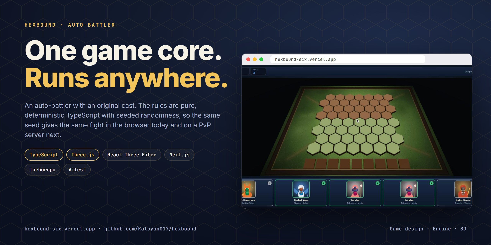
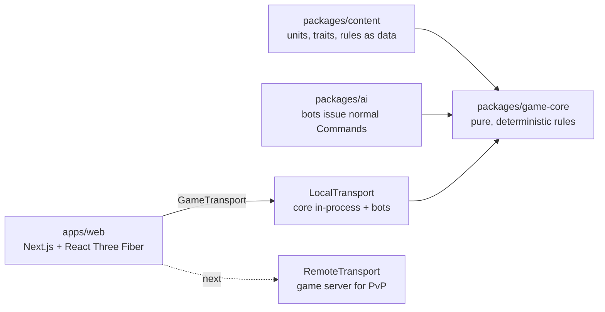

<a href="https://hexbound-six.vercel.app"></a>

<p align="center">
  <a href="https://hexbound-six.vercel.app"></a>
  
  
  
  
</p>

**Hexbound** is an auto-battler with an original cast of 30 characters. You buy units, place them on a hex board and watch them fight. The whole game runs on **one deterministic game core**: it plays offline against bots in the browser today, and the same code will run on a game server for PvP next.

---

## 01 · How a match plays

- **Shop and gold.** Each round you get gold, buy characters from a shop shared by every player, and level up to field more units.
- **Merging.** Three copies of a character merge into a stronger one.
- **Traits.** Characters share traits (Emberkin, Tidebound, Skyward…) that activate as you field more of them.
- **Combat.** The fight plays out automatically on a 3D board, with animated characters, spell effects and sounds.
- **2 to 16 players.** Lobby size is a setting; with an odd number of players alive, one of them fights a ghost copy of another board.

## 02 · Rules the core must keep

The game core in [`packages/game-core`](packages/game-core/src) is pure TypeScript with no React, DOM or network code. It holds three rules:

- **Deterministic.** The same boards, seed and content produce the same combat events in any JavaScript engine. It uses integer math only, and no `Math.random`, `Date.now`, trigonometry or `localeCompare` in `game-core/src`. A test fails if any of them appear. All randomness goes through a seeded [`rng.ts`](packages/game-core/src/rng.ts).
- **Pure.** `applyCommand` and `resolveRound` return new state and never change their input.
- **The lobby size is just a setting.** `createMatch` takes 2–16 seats, and the shared pool scales with the seat count.

Why it matters: **a server can replay any fight from its inputs** to check it, and bots and humans go through exactly the same code path.

## 03 · Architecture



| Path | What it is |
| --- | --- |
| `packages/content` | Units, traits and the rules table as typed data. Adding a character is one entry in `units.ts`. |
| `packages/game-core` | Seeded RNG, hex math, shared pool, shop, merging, planning commands, round resolution and the combat simulation. |
| `packages/ai` | Bots. They issue the same `Command`s as a human, so they can fill seats offline or on the server. |
| `apps/web` | The Next.js app. The UI only talks to a `GameTransport`; `LocalTransport` runs the core in-process with bots. |

## 04 · Run it

```bash
npm install
npm run dev        # http://localhost:3000
npm test           # all packages
npm run typecheck
```

It's a Turborepo monorepo with npm workspaces.

## 05 · Roadmap

1. Move `LocalTransport` into a Web Worker (same interface).
2. Installable offline build with save and resume (Serwist + Dexie).
3. Drag units onto a sell zone; more combat effects (projectiles, stuns).
4. `apps/game-server` (Colyseus) with a `RemoteTransport` for PvP.

## Credits

The 3D characters and animations are from the [KayKit Adventurers](https://kaylousberg.itch.io/kaykit-adventurers) pack by Kay Lousberg (CC0).

---

<p align="center"><sub>Designed and built by <a href="https://github.com/KaloyanG17">Kaloyan Gaydarov</a> · <a href="https://www.linkedin.com/in/kaloyan-gaydarov/">LinkedIn</a></sub></p>
